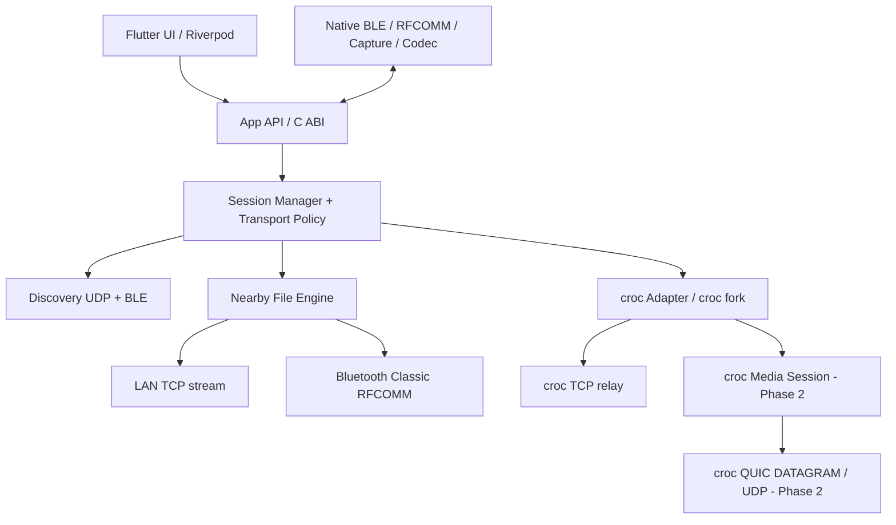
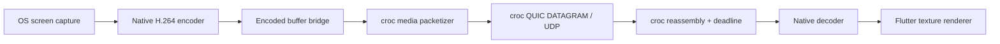

# Đặc tả và định hướng phát triển app croc + Nearby + UDP Screen Streaming

**Ngày lập:** 11/11/2026  
**Trạng thái:** Đặc tả thiết kế, chưa phải báo cáo tính năng đã triển khai.  
**Nguồn tham khảo nội bộ:** `FlCroc-main` trong workspace hiện tại.  
**Nền tảng mục tiêu:** Windows, Linux, Android.  
**Tên sản phẩm:** Chưa đặt; trong tài liệu gọi là **app mới**.

> Quyết định quan trọng nhất: giữ croc, không thay thế croc. Giai đoạn 1 hoàn thành chia sẻ file, discovery và Bluetooth Classic. Giai đoạn 2 mới triển khai streaming màn hình bằng transport UDP mở rộng bên trong lõi croc. Không dùng một đường truyền WebRTC độc lập để bỏ qua croc.

## Mục lục

1. [Yêu cầu và các quyết định đã chốt](#1-yêu-cầu-và-các-quyết-định-đã-chốt)
2. [Kết quả đọc FlCroc và croc](#2-kết-quả-đọc-flcroc-và-croc)
3. [Phạm vi sản phẩm và hành trình người dùng](#3-phạm-vi-sản-phẩm-và-hành-trình-người-dùng)
4. [Kiến trúc tổng thể](#4-kiến-trúc-tổng-thể)
5. [Discovery UDP và BLE](#5-discovery-udp-và-ble)
6. [Danh tính, bắt tay và kênh điều khiển](#6-danh-tính-bắt-tay-và-kênh-điều-khiển)
7. [Chọn đường truyền và sử dụng croc relay](#7-chọn-đường-truyền-và-sử-dụng-croc-relay)
8. [Giao thức file Nearby và Bluetooth Classic](#8-giao-thức-file-nearby-và-bluetooth-classic)
9. [Tích hợp native theo nền tảng](#9-tích-hợp-native-theo-nền-tảng)
10. [Interface giữa UI, Go core và native](#10-interface-giữa-ui-go-core-và-native)
11. [Streaming màn hình trong croc — giai đoạn 2](#11-streaming-màn-hình-trong-croc--giai-đoạn-2)
12. [Giao diện, lưu trữ và trạng thái lỗi](#12-giao-diện-lưu-trữ-và-trạng-thái-lỗi)
13. [Bảo mật và quyền riêng tư](#13-bảo-mật-và-quyền-riêng-tư)
14. [Lộ trình triển khai và điều kiện chuyển giai đoạn](#14-lộ-trình-triển-khai-và-điều-kiện-chuyển-giai-đoạn)
15. [Kiểm thử và tiêu chí nghiệm thu](#15-kiểm-thử-và-tiêu-chí-nghiệm-thu)
16. [Build, phát hành và vận hành](#16-build-phát-hành-và-vận-hành)
17. [Rủi ro, mặc định và phần chưa thuộc phạm vi](#17-rủi-ro-mặc-định-và-phần-chưa-thuộc-phạm-vi)
18. [Tài liệu tham khảo](#18-tài-liệu-tham-khảo)

## 1. Yêu cầu và các quyết định đã chốt

### 1.1. Ý định của người dùng

Tạo app mới có cách tổ chức đa nền tảng tương tự FlCroc, kết hợp ba nhóm khả năng:

- Chức năng gửi/nhận cốt lõi của croc, có UI thay cho thao tác CLI.
- Trải nghiệm chia sẻ cho thiết bị gần giống AirDrop: tìm thiết bị, chọn người nhận, đồng ý nhận, truyền và theo dõi tiến độ.
- Streaming màn hình bằng UDP, nhưng vẫn được quản lý và truyền qua lõi croc đã mở rộng.

AirDrop ở đây là tham chiếu về trải nghiệm. Không có yêu cầu tương thích giao thức Apple AirDrop hoặc gửi trực tiếp sang thiết bị Apple không cài app.

### 1.2. Ma trận quyết định

| Hạng mục | Quyết định từ người dùng |
|---|---|
| Hệ điều hành | Chỉ Windows, Linux, Android |
| Cách dùng FlCroc | Học cách tổ chức multiplatform; không phải giữ nguyên toàn bộ tính năng/UI FlCroc |
| croc | Bắt buộc giữ; không được thay hoàn toàn bằng engine khác |
| Gửi bằng mã | Giữ tương thích croc cho chức năng gửi/nhận cốt lõi |
| Gửi qua Internet | Giữ qua croc/relay |
| Nearby engine | Chấp nhận engine gần riêng bên cạnh croc |
| Discovery | UDP broadcast và BLE |
| Bluetooth truyền file | Bluetooth Classic/RFCOMM |
| BLE | Discovery và control/bootstrap; không phải đường file v1 |
| Ưu tiên file Nearby | LAN → relay server → Bluetooth Classic |
| Relay tự động | Được tự dùng sau khi LAN thất bại |
| Android nhận nền | Mở app để được tìm thấy; tác vụ đã chấp nhận tiếp tục khi chuyển nền |
| Streaming | Giai đoạn 2, sau khi hoàn tất Bluetooth |
| Streaming media path | Qua croc; thêm transport UDP vào lõi |
| Streaming ban đầu | Một chiều, chỉ xem; chưa âm thanh/điều khiển |

**Yêu cầu streaming mới nhất thay thế lựa chọn WebRTC trước đó.** Không tiếp tục kế hoạch dùng Flutter WebRTC như một media transport độc lập cạnh croc.

### 1.3. Phân biệt yêu cầu với đề xuất

Các quyết định trong bảng trên là yêu cầu đã chốt. Những lựa chọn sau là đề xuất kỹ thuật của tài liệu, không phải điều người dùng đã chỉ định đích danh:

- Flutter + Riverpod cho UI; Go cho điều phối, croc và protocol chung.
- Native bridge cho BLE/RFCOMM/capture/codec.
- TLS 1.3 cho kênh Nearby.
- QUIC DATAGRAM trên UDP cho streaming bên trong fork croc.
- Streaming UDP đầu tiên chỉ LAN/hotspot; UDP relay Internet là phần mở rộng về sau.
- Một file transfer hoạt động tại một thời điểm ở bản đầu.

Mỗi đề xuất có thể được điều chỉnh nếu prototype chứng minh không khả thi, nhưng không được làm mất các yêu cầu đã chốt.

## 2. Kết quả đọc FlCroc và croc

### 2.1. Những gì repo hiện có

| Vị trí | Vai trò quan sát được |
|---|---|
| `FlCroc-main/pubspec.yaml` | Flutter, Riverpod, Freezed, FFI, file picker, local preferences |
| `FlCroc-main/lib/core/interface.dart` | Interface init/version/send/receive/cancel/shutdown |
| `FlCroc-main/lib/core/lib_native.dart` | Nạp Go shared library, gọi FFI, poll progress |
| `FlCroc-main/lib/core/controller.dart` | Ưu tiên FFI, có fallback sang process backend |
| `FlCroc-main/go_bridge/main.go` | C ABI cho croc; session và hàng đợi progress |
| `FlCroc-main/go_bridge/go.mod` | Dùng croc vendored qua `replace` |
| `FlCroc-main/submodules/croc` | Fork croc hiện được FlCroc dùng |
| `FlCroc-main/docs/BUILD.md` | Hướng dẫn build và đóng gói native library |
| `FlCroc-main/.github/workflows` | Build/lint/test theo nền tảng |

README công bố Windows, Linux, macOS và Android. Thư mục nền tảng tồn tại không có nghĩa nền tảng đó đã được kiểm chứng phát hành. App mới chỉ lấy Windows/Linux/Android theo yêu cầu.

### 2.2. Các giới hạn liên quan trực tiếp

1. Bridge quản lý một biến `active` cho phiên truyền. Không thể mặc định dùng nguyên bridge này cho nhiều file session và streaming song song.
2. `CrocPollProgress` đọc sự kiện từ phiên đang active. App mới cần ID rõ ràng và không để sự kiện phiên cũ lẫn phiên mới.
3. `croc.ParseTransportMode` hiện nhận `auto`, `derp`, `relay`. Thêm chuỗi `udp` vào UI không tạo ra UDP transport thực sự.
4. `src/comm/comm.go` dùng `net.Conn`, dial TCP và framing độ dài. UDP không có tính chất byte stream nên không thể thay bằng `net.PacketConn` rồi giữ nguyên logic đọc/ghi.
5. Đường Tailcat hiện có abstraction nhưng vẫn cung cấp TCP streams; tên transport hoặc lớp mạng nền không đồng nghĩa media đã dùng datagram có deadline.
6. Bridge có cơ chế bỏ sự kiện khi consumer chậm. Bản mới phải đảm bảo terminal event luôn quan sát được.
7. Mã fallback ở phía Dart sinh share code từ thời gian. Không sao chép cách này cho invitation bí mật của app mới; dùng CSPRNG hoặc API sinh mã an toàn của core.
8. Một số nhận định toolchain trong README và BUILD có thể khác nhau; khi triển khai phải pin theo build thực tế đã xác minh.

### 2.3. Phần nên học và phần nên xây mới

**Nên học:** Flutter app + Go shared library, packaging theo OS/ABI, chia UI/state/model, CI build matrix, cách chuyển progress sang UI, file picker và file history.

**Nên xây mới:** discovery, danh tính peer, phiên Nearby, policy chọn đường, RFCOMM adapter, transport capability model, foreground lifecycle và media session trong croc.

Không clone toàn bộ UI/feature FlCroc chỉ để rồi phải giữ các cấu hình không còn liên quan. Nếu tái sử dụng mã trực tiếp, giữ attribution và kiểm tra điều khoản giấy phép của phần lấy lại; FlCroc có GPLv3, croc trong cây nguồn có MIT.

## 3. Phạm vi sản phẩm và hành trình người dùng

### 3.1. Gửi bằng mã croc

1. Chọn file/nhiều file/thư mục hoặc nhập text.
2. App yêu cầu core tạo phiên gửi và share code.
3. Hiển thị mã, nút copy và QR cho mã nhận của app.
4. Người nhận nhập mã trên app hoặc dùng croc CLI tương thích.
5. App hiển thị trạng thái chờ, kết nối, truyền, hoàn tất hoặc lỗi.
6. Cho hủy và thử lại; resume tuân theo khả năng thực tế của phiên bản croc pin.

QR của app không được tự cam kết tương thích web receive. Giữ mã croc là yêu cầu; browser receive không nằm trong v1.

### 3.2. Gửi cho thiết bị gần

1. Hai bên mở app; quyền discovery được cấp theo nhu cầu.
2. Thiết bị hiện trong danh sách nhờ UDP hoặc BLE.
3. Người gửi chọn nội dung và peer.
4. Hai bên thiết lập kênh điều khiển, xác minh lần đầu nếu chưa tin cậy.
5. Người nhận xem yêu cầu và chọn nhận/từ chối.
6. Core chọn LAN, relay hoặc Classic theo policy.
7. UI hiển thị đường đang dùng, tốc độ, byte thực nhận và khả năng hủy.
8. Sau thành công, người nhận có thể mở file/thư mục; lịch sử lưu metadata tối thiểu.

### 3.3. Streaming — chỉ sau giai đoạn Bluetooth

1. Chọn peer có capability streaming mới của croc.
2. Người phát chọn chia sẻ màn hình; người xem chấp nhận.
3. Hệ điều hành cấp quyền capture riêng.
4. croc thiết lập media session và UDP transport.
5. Màn hình được encode, đưa qua croc, truyền UDP, decode và render.
6. Một trong hai bên dừng; capture, encoder, UDP socket và session được giải phóng.

## 4. Kiến trúc tổng thể



### 4.1. Ranh giới trách nhiệm

- **UI:** hiển thị và nhận thao tác; không tự chọn transport bằng một loạt điều kiện trong widget.
- **Session Manager:** danh tính, lifecycle, session ID, policy, request/accept/cancel.
- **CrocAdapter:** gọi croc theo API; dịch progress/error; giữ tương thích gửi mã.
- **NearbyEngine:** protocol file chung trên LAN TCP và RFCOMM.
- **Discovery:** tìm candidate, không tự xác nhận danh tính đáng tin.
- **Native adapters:** thực thi API OS, trả capabilities và byte/frame buffers; không chứa business policy.
- **Croc Media Session:** mọi media offer, xác thực UDP, gửi/nhận encoded video, thống kê và đóng phiên của giai đoạn 2.

### 4.2. Tổ chức nguồn đề xuất cho app mới

```text
new-app/
  app/                  Flutter application
    lib/features/       nearby, code_transfer, tasks, settings, streaming
    lib/core/           api bindings, models, state integration
    android/ windows/ linux/
  core/                 Go application core + C ABI bridge
    discovery/ session/ nearby/ policy/ platformio/
    crocadapter/ storage/
  native/               Platform adapters and media components
  third_party/croc/     Pinned croc fork
  protocol/             Versioned message specs and test vectors
  tests/                Integration harness and fixtures
  docs/                 Design, build, compatibility, test reports
```

Đây là cấu trúc cho bước triển khai sau, chưa tạo app skeleton trong nhiệm vụ viết tài liệu này.

### 4.3. Trạng thái và vòng đời

File task: `queued → preparing → awaiting_peer → awaiting_acceptance → connecting → transferring → verifying → completed`.

Trạng thái kết thúc khác: `rejected`, `cancelled`, `failed`. Khi hỗ trợ retry/resume, tạo attempt mới dưới cùng task; không dùng một progress counter tăng vô hạn qua mọi lần gửi lại.

Phân biệt:

- `peer_id`: danh tính đã xác thực, không phải IP/MAC.
- `discovery_token`: định danh tạm theo lần mở/chế độ discoverable.
- `session_id`: kênh điều khiển đã xác thực.
- `transfer_id`: tác vụ người dùng.
- `attempt_id`: một lần chọn đường/kết nối/truyền.
- `media_session_id`: phiên streaming giai đoạn 2.

## 5. Discovery UDP và BLE

### 5.1. UDP broadcast

Đề xuất v1 dùng IPv4 LAN; IPv6 discovery để sau vì IPv6 không có broadcast tương đương.

- Bind UDP discovery port mặc định đề xuất `43127`, cho phép thay khi cấu hình triển khai yêu cầu.
- Gửi tới broadcast theo subnet của interface thực, không chỉ `255.255.255.255`.
- Mặc định loại loopback và interface VPN/ảo; vẫn cho chọn interface thủ công khi cần.
- Khi app hiển thị Nearby: gửi announcement mỗi 2 giây có jitter; peer hết hạn sau 10 giây không có tín hiệu.
- Kết quả là candidate cùng nguồn nhận packet và interface; không tin endpoint tùy ý do packet quảng cáo để tránh ép app dial địa chỉ bên ngoài LAN.
- Giới hạn announcement 512 byte, giới hạn parse và rate theo nguồn.

Thông tin logic: phiên bản discovery, token tạm, cổng control LAN, capability bitmap và tên hiển thị tùy chọn. Không có share code, khóa phiên, tên file hoặc đường dẫn.

Tên hiển thị broadcast được coi là dữ liệu công khai trên LAN. Cho người dùng đổi biệt danh; không tự dùng tên tài khoản OS nếu chưa cần.

UDP discovery không vượt router, VLAN, AP isolation hoặc firewall. Không có kết quả UDP chưa đủ kết luận peer offline.

### 5.2. BLE discovery và GATT bootstrap

- Dùng service UUID 128-bit riêng cho app.
- Legacy advertisement có giới hạn payload nhỏ; ưu tiên UUID trong advertisement, metadata trong GATT. Không yêu cầu extended advertising để hoạt động cơ bản.
- Discovery token đọc qua characteristic metadata rồi hợp nhất với kết quả LAN.
- GATT control dùng characteristic RX/write và TX/notify, có framing, chunk theo MTU và backpressure.
- Dữ liệu nhạy cảm chỉ trao đổi sau khi kênh TLS trên GATT đã xác thực.
- Không suy luận địa chỉ RFCOMM từ địa chỉ BLE, vì random address và danh tính hai chế độ có thể khác nhau.
- Endpoint Classic được resolve từ API OS/SDP và thông tin bootstrap đã xác thực; prototype phải chứng minh cách mapping ở từng cặp OS.

Một bên có thể scan nhưng không advertise được. Client/server BLE không đồng nghĩa người gửi/người nhận file. Cho phép đảo vai trò kết nối khi capabilities cho phép.

Nếu cả hai adapter không làm peripheral/GATT server được, BLE bootstrap không khả dụng. App vẫn có UDP LAN, mã croc hoặc ghép đôi/resolve Classic thủ công; hiển thị hạn chế thay vì giả vờ tất cả đường đều hỗ trợ.

### 5.3. Hợp nhất và chống dữ liệu cũ

- Trước xác thực: hợp nhất theo token phiên, giữ nhãn “chưa xác minh”.
- Sau xác thực: gắn các endpoint vào peer có khóa đã kiểm tra.
- IP đổi chỉ cập nhật endpoint, không tạo peer đáng tin mới.
- Thay khóa thiết bị phải báo lại; không kế thừa trust chỉ vì tên giống nhau.
- Dừng discovery khi app đóng hoặc Nearby không hoạt động; khi tác vụ đang chạy có thể giữ control cần thiết nhưng không tiếp tục broadcast vô hạn.

## 6. Danh tính, bắt tay và kênh điều khiển

### 6.1. Kênh Nearby

Đề xuất TLS 1.3 với certificate thiết bị tự quản lý, chạy trên stream LAN hoặc GATT đã được adapter biến thành byte stream có thứ tự.

- Lần đầu chưa biết khóa: handshake tạo kênh tạm; hai bên đối chiếu SAS 6 chữ số dẫn xuất từ TLS exporter với domain separation cố định.
- Chỉ sau khi cả hai xác nhận SAS mới cho gửi metadata nhạy cảm, croc code hoặc payload.
- SAS không phải mật khẩu mã hóa và không phải bằng chứng tự động từ tên thiết bị. Giới hạn số lần thử và timeout để giảm khả năng đoán mã.
- Sau khi người dùng chọn tin cậy, lưu fingerprint/public key. Lần sau pin khóa và kiểm tra trước khi cho thao tác.
- Người dùng vẫn phải chấp nhận từng yêu cầu file/stream trong v1, kể cả peer đã tin cậy.

Thiết kế SAS và key storage phải có test vectors và review bảo mật trước phát hành. Không tự tạo cipher, AEAD hoặc thuật toán trao đổi khóa.

### 6.2. Control message

Control frame: length-prefixed, JSON v1, tối đa 64 KiB/frame, có `protocol_version`, `message_type`, `session_id`, `request_id` và payload theo loại.

Nhóm message:

- `hello`, `capabilities`, `verify`, `ping`, `close`.
- `transfer_offer`, `transfer_accept`, `transfer_reject`, `transfer_cancel`.
- `route_offer`, `route_result`, `croc_invitation`, `attempt_status`.
- Giai đoạn 2 thêm `media_offer`, `media_accept`, `media_transport_offer`, `media_feedback`, `media_stop`.

Manifest lớn không nhét vào một control frame; có phân trang hoặc truyền trên file data channel sau khi được chấp nhận.

### 6.3. Điểm quan trọng của relay tự động

Biết một thiết bị tồn tại qua BLE chưa đủ để tự gửi file bằng croc relay. Hai bên phải trao đổi lời mời và mã nhận qua một kênh control đã xác thực.

V1 dùng control LAN hoặc BLE GATT để làm rendezvous. Nếu không có control khả dụng, yêu cầu nhập/chia sẻ mã croc thủ công. Không tự broadcast share code để né vấn đề này, và không mặc định có server discovery trung tâm.

## 7. Chọn đường truyền và sử dụng croc relay

### 7.1. Policy chính thức

```text
Nearby mặc định:
    LAN trực tiếp
      → croc relay
        → Bluetooth Classic

Nearby chỉ offline:
    LAN trực tiếp
      → Bluetooth Classic

Gửi bằng mã:
    Theo cơ chế croc tương thích hiện có

Streaming giai đoạn 2:
    croc UDP trực tiếp trong LAN/hotspot
```

Thứ tự file Nearby không áp dụng máy móc cho streaming. Streaming không fallback sang TCP relay hoặc Bluetooth trong bản đầu vì như vậy không đáp ứng đường media UDP đã chọn.

### 7.2. Cách thực hiện policy

1. Sau chấp nhận, kiểm tra endpoint LAN ứng với peer đã xác thực; deadline kết nối 3 giây.
2. Nếu LAN không dùng được và không bật offline-only, gửi invitation croc qua control.
3. Hai bên khởi chạy croc với cấu hình ép relay tương ứng phiên bản pin; không dùng `auto` nếu nó có thể chọn lại đường ngoài policy.
4. Thời gian thiết lập relay mặc định 15 giây; timeout/lỗi network mới chuyển sang Classic.
5. Classic resolve/pair/connect có thời gian chờ tối đa 60 giây và hiển thị rõ đang chờ hệ điều hành ghép đôi.
6. Sau khi một attempt thắng, đóng mọi attempt thừa và ghi route thực dùng.

Các timeout là mặc định kỹ thuật ban đầu, cấu hình được trong core, điều chỉnh theo số đo thiết bị thật.

### 7.3. Không fallback sai nguyên nhân

Được fallback: không kết nối được, route unavailable, relay unreachable, Bluetooth unsupported, timeout thiết lập.

Không tự fallback: xác thực thất bại, peer từ chối, người dùng hủy, sai manifest, checksum sai, thiếu dung lượng. Các trường hợp này cần dừng hoặc xử lý đúng lỗi thay vì thử transport khác để vượt quyết định của người nhận.

### 7.4. Resume và chuyển engine

- LAN ↔ Classic dùng chung Nearby protocol nên có thể dùng lại checkpoint đã xác minh khi retry, nhưng không cần seamless migration ở v1.
- Relay croc có protocol resume riêng. Không coi checkpoint Nearby là checkpoint croc.
- V1 chỉ tự fallback trước khi bắt đầu payload. Gián đoạn giữa payload: dừng attempt, báo khả năng resume/retry.
- Nếu người dùng đổi từ Nearby sang croc hoặc ngược lại, khởi động lại dữ liệu và báo rõ; không cộng byte truyền cũ vào tiến độ thành công.

## 8. Giao thức file Nearby và Bluetooth Classic

### 8.1. Stream transport

LAN TCP và RFCOMM đều được expose qua interface reliable ordered stream có read/write/close/deadline. Trên đó chạy TLS và framing Nearby.

RFCOMM là Bluetooth Classic, không phải BLE GATT và không phải OBEX. V1 dùng service UUID riêng để hai bản app kết nối; không yêu cầu OS file sharing/OBEX tương thích.

### 8.2. Manifest và ghi file

Manifest chứa ID file, relative path chuẩn hóa, size và SHA-256 cuối cùng. Khi chuẩn bị file lớn, có thể tính hash trong luồng đọc thay vì đọc toàn bộ file vào RAM; người nhận chỉ đánh dấu thành công sau khi đối chiếu hash hoàn tất.

- Logical chunk mặc định 256 KiB; native I/O chia buffer nhỏ hơn theo transport.
- Mỗi chunk có file ID, offset, length và digest phục vụ checkpoint.
- ACK chỉ xác nhận dữ liệu đã ghi theo chính sách checkpoint, không chỉ đã vào UI buffer.
- Lưu `.part` và sidecar checkpoint; hoàn tất hash rồi atomic rename trong cùng filesystem khi có thể.
- Resume chỉ dùng phần dữ liệu đã kiểm tra, và phải kiểm tra nguồn chưa đổi bằng manifest/digest tương ứng.
- File nguồn đổi trong lúc gửi: fail rõ; không tạo file người nhận có nội dung pha trộn.

### 8.3. Đường dẫn và nội dung

- Từ chối absolute path, `..`, NUL và đường dẫn thoát thư mục đích.
- Không follow symlink trong thư mục gửi ở v1; báo mục bị bỏ qua.
- Với tên không hợp lệ trên Windows, tạo tên hợp lệ và giữ mapping trong metadata tác vụ; không ghi đè do hai tên normalize trùng nhau.
- Tên trùng mặc định tạo bản sao có hậu tố. Ghi đè chỉ khi người nhận chủ động chọn.
- Text Nearby là UTF-8 với giới hạn mặc định 1 MiB; không tự ghi vào clipboard.
- Không chạy file sau khi nhận và không tự giải nén archive từ người gửi.

### 8.4. Bluetooth lifecycle

Dừng inquiry/scan không cần thiết khi bắt đầu payload nếu nó gây giảm throughput. Không hardcode tốc độ hoặc hứa truyền file lớn nhanh ngang Wi-Fi.

Adapter RFCOMM phải hỗ trợ read partial, write partial, timeout, cancel và close idempotent. Giải phóng socket khi peer rời hoặc người dùng hủy; không treo thread chờ read vô thời hạn.

## 9. Tích hợp native theo nền tảng

### 9.1. Android

- Kotlin: BLE scanner/advertiser, GATT client/server, BluetoothSocket và BluetoothServerSocket.
- API Android 12+ yêu cầu quyền scan/advertise/connect theo thao tác; các phiên bản cũ có yêu cầu location cho scan cần xử lý theo API level.
- Foreground service cho tác vụ đã được người dùng chấp nhận; khai báo service type và điều kiện khởi chạy theo target SDK thực tế.
- Service/core sở hữu tác vụ, không để phiên phụ thuộc vòng đời widget hoặc Dart subscription.
- Content URI từ file picker/SAF không phải filesystem path. Cần bridge đọc/ghi qua file descriptor hoặc staging có kiểm tra dung lượng; không giả định Go `os.Open(uri)` chạy được.
- Thư mục lưu và quyền URI phải phù hợp scoped storage; handle trường hợp người dùng thu hồi quyền.
- OS có thể kill/force-stop; không cam kết phiên tồn tại sau force-stop. Checkpoint giúp retry khi mở lại.

### 9.2. Windows

- C++/WinRT cho BLE advertisement watcher, GATT server/client và RFCOMM.
- Kiểm tra adapter, peripheral role, radio và packaging/capability yêu cầu thực tế của ứng dụng desktop.
- Thử cả packaged và định dạng phân phối dự kiến; không suy luận sample UWP sẽ dùng nguyên trạng trong Flutter Win32.
- Firewall: giải thích và cấu hình tối thiểu cho discovery/control; không tắt firewall toàn hệ thống.
- Pairing do OS quản lý. Có trạng thái “chờ ghép đôi” và hướng dẫn người dùng khi bị policy chặn.

### 9.3. Linux

- BlueZ D-Bus cho adapter, discovery, advertising/GATT, SDP/ProfileManager và RFCOMM connection FD.
- Không yêu cầu app chạy root. Thiếu quyền D-Bus/polkit phải được nhận diện và hướng dẫn theo distro.
- Adapter phải thực sự hỗ trợ Classic nếu muốn RFCOMM, và peripheral nếu muốn BLE advertise.
- Prototype trên BlueZ và desktop session của distro mục tiêu; không mặc định mọi dongle USB đều tương đương.
- Hotplug Bluetooth, restart BlueZ, suspend/resume phải đóng/mở lại state đúng.

### 9.4. Ma trận capability runtime

```text
udp_discovery
ble_scan
ble_advertise
ble_gatt_client
ble_gatt_server
classic_client
classic_server
file_send
file_receive
croc_relay
screen_capture       # phase 2
screen_decode        # phase 2
croc_udp_media       # phase 2
```

Mỗi capability có availability và reason: unsupported, permission_denied, radio_off, service_missing, busy hoặc available. UI hiển thị đúng nguyên nhân.

## 10. Interface giữa UI, Go core và native

### 10.1. API sản phẩm đề xuất

```text
AppCore.init(config) / shutdown()
Discovery.start() / stop() / peers()
Session.connect(peerRef) / verify() / close()
Transfer.sendToPeer(peerId, sourceRefs, options)
Transfer.sendByCode(sourceRefs, options)
Transfer.receiveByCode(code, destination, options)
Transfer.accept(requestId, destination) / reject(requestId)
Transfer.cancel(transferId) / retry(transferId)
Events.subscribe(afterSequence)

# Chỉ triển khai giai đoạn 2
Screen.start(peerId, sourceRef, profile)
Screen.accept(mediaRequestId) / stop(mediaSessionId)
Screen.stats(mediaSessionId)
```

Các tên ở đây là contract định hướng, không phải symbol đã tồn tại trong repo.

### 10.2. Event envelope

```json
{
  "api_version": 1,
  "sequence": 42,
  "type": "transfer.progress",
  "session_id": "...",
  "transfer_id": "...",
  "attempt_id": "...",
  "payload": {
    "route": "bluetooth_classic",
    "bytes_verified": 1048576,
    "bytes_total": 8388608
  }
}
```

- Sequence tăng trong vòng đời core, giúp phát hiện event bị hụt.
- Progress có thể coalesce; complete/fail/cancel không được bỏ.
- Nếu subscriber chậm, trả snapshot trạng thái để đồng bộ lại.
- Không đưa frame video hoặc payload file vào JSON event.
- JSON errors có code ổn định, thông điệp kỹ thuật đã bỏ bí mật và cờ retryable; UI tự bản địa hóa.

### 10.3. Bộ nhớ và concurrency FFI

- Core cấp opaque handle; mỗi resource có owner và hàm release rõ ràng.
- C ABI có version negotiation; backend sai version phải fail có thông báo.
- Không gọi callback Dart trên thread native tùy ý; dùng cơ chế Dart port/native callback đúng runtime hoặc poll event batch trên worker isolate.
- Không block UI isolate bởi connect, hash, disk I/O hoặc native Bluetooth call.
- Hàng đợi byte/frame có giới hạn. Khi đầy: file stream backpressure; media drop theo deadline.
- Cancel là idempotent; final state xuất hiện đúng một lần; close không chờ vô hạn.

### 10.4. Bridge Bluetooth hoạt động khi Android chuyển nền

Không dùng Flutter MethodChannel như chủ sở hữu duy nhất của RFCOMM đang truyền. Đề xuất native service giữ socket và native I/O bridge; Go giao tiếp qua C ABI/FD hoặc queue native có wakeup và deadline. MethodChannel chỉ điều khiển UI/capability.

Cần prototype chứng minh app không treo khi Activity bị recreate hoặc UI isolate tạm ngừng. Tránh chuyển từng packet qua Dart rồi quay lại Go trong hot path.

## 11. Streaming màn hình trong croc — giai đoạn 2

### 11.1. Ý nghĩa chính xác của “đi qua croc”

Phải đạt tất cả các điều kiện:

1. croc fork sở hữu media session, capability negotiation và lifecycle.
2. Media offer/accept và thông tin transport đi qua control channel đã xác thực của croc.
3. croc kiểm tra binding giữa phiên control và peer UDP.
4. Encoded video được gửi/nhận qua API media của croc và transport UDP do croc quản lý.
5. Thống kê và lỗi transport trở về app qua croc bridge.
6. Không có socket video độc lập do Flutter/native tự mở để đi vòng qua croc.

Capture, encode, decode và render vẫn là trách nhiệm native/media components. croc không cần trở thành thư viện codec; nó quản lý media protocol và network path.

### 11.2. Không sửa TCP thành UDP tại một điểm

File transfer hiện yêu cầu reliable stream; video realtime có thể bỏ dữ liệu cũ. Hai kiểu I/O phải khác interface:

```go
// Phác thảo thiết kế, không phải API có sẵn.
type ReliableStream interface {
    Read([]byte) (int, error)
    Write([]byte) (int, error)
    Close() error
    SetDeadline(time.Time) error
}

type MediaDatagramTransport interface {
    MaxPayloadSize() int
    Send(ctx context.Context, packet []byte) error
    Receive(ctx context.Context) ([]byte, error)
    Stats() TransportStats
    Close() error
}
```

Không giả lập UDP bằng `net.Conn` có reliable buffering cho media; làm vậy dễ tái tạo head-of-line blocking. Không đưa video vào vòng lặp file chunk/ACK/resume cũ.

### 11.3. Transport đề xuất: QUIC DATAGRAM bên trong croc

Chọn hướng mặc định **QUIC + DATAGRAM extension**, chạy trực tiếp trên UDP:

- QUIC cung cấp handshake TLS, mã hóa, kiểm soát nghẽn và connection lifecycle.
- DATAGRAM cho video không yêu cầu retransmit đầy đủ dữ liệu cũ.
- Reliable control/feedback bổ sung có thể đi trên QUIC stream sau khi transport đã được croc xác thực.
- Tính năng được đóng trong package transport/media của croc fork; app không điều khiển một WebRTC PeerConnection độc lập.
- Không dùng QUIC reliable stream làm đường video mặc định, vì stream đáng tin sẽ chờ retransmission.

QUIC là lựa chọn triển khai UDP, không phải yêu cầu “UDP thô” từ người dùng. Nếu prototype chứng minh thư viện QUIC không đáp ứng target ABI hoặc media deadline, phải có ADR thay thế bằng RTP/SRTP hoặc UDP có bảo mật chuẩn; không tự chuyển sang TCP mà vẫn gọi là UDP.

Tham khảo: [RFC 9000](https://www.rfc-editor.org/rfc/rfc9000.html), [RFC 9221](https://www.rfc-editor.org/rfc/rfc9221), [RFC 9002](https://www.rfc-editor.org/rfc/rfc9002.html).

### 11.4. Xác thực và bind UDP vào phiên croc

1. Hai peer có croc control session đã qua PAKE/xác thực.
2. Negotiate capability `screen-stream-v1` và `media-quic-datagram-v1` qua feature negotiation tương thích.
3. Trao đổi media session ID ngẫu nhiên, endpoint candidates, certificate fingerprint tạm và nonce qua control đã mã hóa.
4. QUIC handshake bắt buộc pin fingerprint đã trao đổi; ALPN riêng có version.
5. Thực hiện session-binding challenge/response dùng vật liệu dẫn xuất từ khóa croc qua HKDF với context riêng, hoặc API binding đã review tương đương. Không xuất khóa PAKE thô sang UI.
6. Chỉ bật nhận media sau khi binding và user acceptance hoàn tất.
7. Đóng control session sẽ đóng media session tương ứng; các timeout không để media chạy vô danh.

Không nhận UDP từ bất kỳ sender nào chỉ vì header có đúng session ID. Session ID là định tuyến, không phải bí mật đủ để xác thực.

### 11.5. Compatibility với croc gốc

- File bằng mã vẫn hoạt động với croc CLI tương thích.
- Streaming yêu cầu cả hai bên có croc fork hỗ trợ media extension.
- Peer cũ không có capability: trả `unsupported_feature`, không gửi message media tùy ý vào state machine file cũ.
- Media negotiation có session type riêng hoặc entrypoint riêng; không giả một screen stream thành file vô hạn.
- Feature được negotiate sau khi kết nối bằng cách tương thích; không thay PAKE wire format làm hỏng peer cũ.
- Không thêm enum `udp` vào mọi nơi rồi cho file auto dùng nó. File transport policy và media transport policy là hai thứ khác nhau.

### 11.6. Pipeline media



- Encoded access units qua native/C ABI, không base64/JSON.
- Bản đầu cho phép một lần copy encoded buffer có đo đạc; không bắt đầu bằng zero-copy phức tạp khi chưa cần.
- Raw RGBA frames không chạy vòng qua Dart/Go.
- Decoder output render bằng texture native, không rebuild widget cho mỗi frame.

### 11.7. Capture và codec theo nền tảng

| Nền tảng | Capture đề xuất | Encode/decode đề xuất |
|---|---|---|
| Windows | Windows Graphics Capture | Media Foundation, ưu tiên hardware H.264 |
| Android | MediaProjection/VirtualDisplay | MediaCodec surface encoder/decoder |
| Linux Wayland | XDG ScreenCast portal + PipeWire | GStreamer H.264, hardware khi có |
| Linux X11 | Capture qua pipeline X11 phù hợp | GStreamer H.264 |

Linux phải kiểm tra plugin codec thực có mặt trong gói/distro. Nếu H.264 unavailable, báo capability thiếu và hướng dẫn dependency; không tự đổi codec không được negotiate. Codec khác là mở rộng sau.

Android yêu cầu đồng ý capture từng phiên và foreground service mediaProjection theo API/target SDK. Nội dung được OS bảo vệ có thể đen; không tìm cách vượt cơ chế bảo vệ. Windows cũng kiểm tra support và quyền capture trước khi bắt đầu.

Nguồn: [Android MediaProjection](https://developer.android.com/media/grow/media-projection), [Windows screen capture](https://learn.microsoft.com/en-us/windows/apps/develop/media-authoring-processing/screen-capture), [PipeWire portal](https://docs.pipewire.org/page_portal.html).

### 11.8. Profile video ban đầu

- Một sender, một viewer; một màn hình hoặc cửa sổ được chọn.
- Codec mặc định H.264 low-latency, 8-bit 4:2:0; negotiate profile/level hai bên cùng hỗ trợ.
- Độ phân giải khởi đầu tối đa 1280×720, 30 fps; có thể giảm khi màn hình nguồn nhỏ hơn.
- Bitrate khởi đầu 2 Mbps, khoảng điều chỉnh dự kiến 0,5–5 Mbps theo loss, queue và encoder.
- Tắt B-frame khi backend hỗ trợ cấu hình; keyframe định kỳ khoảng 1–2 giây và theo yêu cầu mất sync.
- Khi giảm chất lượng: giảm bitrate trước, sau đó fps/độ phân giải theo bậc đã cấu hình; tránh đổi liên tục bằng hysteresis.
- Khi đổi resolution/rotation: gửi codec configuration và discontinuity/version mới trước frame tương ứng.

Các con số là mục tiêu prototype, không phải cam kết hiệu năng mọi thiết bị.

### 11.9. Media framing

Croc media v1 dùng binary header có version, media session, stream ID, frame ID, timestamp tương đối, fragment index/count và flags keyframe/configuration/discontinuity.

- Không gửi một encoded frame lớn thành một UDP packet.
- Kích thước fragment lấy từ khả năng DATAGRAM thực của QUIC sau khi trừ header; giới hạn payload ứng dụng ban đầu tối đa 1.000 byte khi transport cho phép, và tự giảm theo negotiated maximum.
- Một frame giới hạn 4 MiB; số fragment và tổng bộ nhớ reassembly có upper bound.
- Giới hạn receiver reassembly tổng 16 MiB và số frame đang ghép; vượt giới hạn thì bỏ frame cũ và yêu cầu keyframe có rate limit.
- Không dựa vào IP fragmentation để vận hành bình thường.
- Timestamp là media clock tương đối, không coi đồng hồ hệ thống hai thiết bị đồng bộ.

Header wire layout cụ thể được viết thành spec/test vectors ở milestone media; các trường và giới hạn ở trên là contract thiết kế.

### 11.10. Deadline, jitter, loss và congestion

- Jitter target ban đầu 40–80 ms, điều chỉnh có giới hạn; không tích lũy queue để giữ đủ mọi frame.
- Send queue tối đa 2 encoded frames hoặc 100 ms media; frame quá hạn bị drop trước khi đưa vào QUIC.
- Nếu frame tham chiếu bị mất, decoder có thể mất sync; cho drop chuỗi phụ thuộc và yêu cầu keyframe, không giả định có thể render mọi P-frame kế tiếp.
- Receiver bỏ frame không ghép đủ sau deadline dự kiến tối đa 150 ms; timestamp/frame sequence giúp phân biệt frame cũ và reorder.
- Feedback mỗi 250–500 ms: RTT, loss quan sát được, queue delay, dropped frames, decode/render fps.
- QUIC có congestion control nhưng app vẫn phải giảm bitrate encoder theo tín hiệu vận chuyển. Không tăng bitrate chỉ vì socket write thành công.
- NACK/FEC chưa bắt buộc v1 media; chỉ thêm sau số đo nếu có ích trong deadline.
- Keyframe request rate-limited, tránh tấn công hoặc keyframe storm.

### 11.11. LAN, NAT và relay UDP

Streaming giai đoạn 2 bản đầu dùng UDP trực tiếp trong LAN/hotspot. croc control có thể dùng đường TCP hiện có để xác thực/trao đổi endpoint, nhưng **video payload phải dùng UDP**.

Phân biệt rõ:

- Control qua TCP không làm sai yêu cầu UDP media.
- Video đi trong TCP relay vẫn là TCP media, không được gắn nhãn UDP.
- Relay croc hiện có không mặc định hỗ trợ QUIC forwarding.
- Streaming Internet cần NAT traversal và/hoặc UDP relay riêng; đây là milestone bổ sung, không âm thầm dùng relay TCP.
- Nếu UDP bị chặn, báo `udp_unavailable`; chức năng file vẫn hoạt động bình thường.

Nếu sau này thêm UDP relay: cần room token có hạn, kiểm chứng địa chỉ, chống amplification, rate/bandwidth quota, mã hóa end-to-end và đo chi phí vận hành. Không quảng bá streaming Internet trước khi hoàn thành phần đó.

### 11.12. Lifecycle và giới hạn concurrency

Media session: `offered → accepted → capture_permission → negotiating → connecting_udp → streaming → stopping → stopped/failed`.

- Dừng capture ngay khi người phát/OS thu hồi quyền, peer ngắt hoặc user stop.
- Renderer không được giữ frame cũ mà khiến user tưởng vẫn live; hiển thị trạng thái gián đoạn.
- Bản đầu streaming dùng một phiên duy nhất và không chạy đồng thời payload file. UI cho xếp hàng file và bắt đầu sau stream.
- Discovery/control vẫn có thể hoạt động, nhưng không làm giảm chất lượng media bằng scan vô ích.

## 12. Giao diện, lưu trữ và trạng thái lỗi

### 12.1. Các màn hình

1. **Thiết bị gần:** peer, nguồn discovery, trạng thái, chọn nội dung.
2. **Gửi/nhận bằng mã:** code, copy, QR, relay settings nâng cao.
3. **Tác vụ:** trạng thái, route, tổng byte, byte verified, tốc độ, ETA nếu đủ dữ liệu, cancel/retry.
4. **Lịch sử:** nội dung đã nhận/gửi, thời gian, kết quả, mở vị trí lưu.
5. **Cài đặt:** tên hiển thị, discoverable, offline-only, relay, nơi lưu, trust, xóa lịch sử.
6. **Chia sẻ màn hình:** chỉ xuất hiện khi phase 2 và capability sẵn sàng.

### 12.2. Dữ liệu local

- SQLite cho task/history/checkpoint metadata; migration versioned.
- OS credential store/keystore cho khóa và secret; Linux dùng secret service khi khả dụng, fallback file private permission phải có thiết kế và thông báo capability phù hợp.
- Checkpoint gắn đường file tạm, manifest digest, peer và engine.
- Không persist mã croc plaintext trong history, không lưu file content/text nếu chỉ cần metadata.
- Xóa lịch sử không tự xóa file đã nhận; xóa file tạm là thao tác riêng có hiển thị dung lượng.

### 12.3. Lỗi cần được phân biệt

`permission_denied`, `radio_off`, `unsupported_capability`, `peer_expired`, `authentication_failed`, `request_rejected`, `route_timeout`, `relay_unavailable`, `pairing_required`, `pairing_failed`, `disk_full`, `source_changed`, `path_invalid`, `checksum_mismatch`, `cancelled`, `udp_unavailable`, `codec_unavailable`, `capture_revoked`.

Không hiển thị mọi trường hợp là “kết nối thất bại”. Error state phải gợi đúng hành động: cấp quyền, bật radio, mở app bên kia, thử route khác hoặc chọn nơi lưu.

## 13. Bảo mật và quyền riêng tư

### 13.1. Threat model tối thiểu

Xét kẻ ở cùng LAN/Bluetooth range có thể giả announcement, gửi metadata độc hại, làm flood connect, mạo danh tên, gửi invitation lặp, hoặc nghe lén broadcast. Xét relay có thể nhìn metadata mạng nhưng không được đọc file plaintext theo cơ chế croc.

### 13.2. Yêu cầu bắt buộc

- Không tin discovery trước xác thực; không auto-accept dựa trên tên hoặc MAC.
- Giới hạn frame/message/file count, queue, memory và thời gian handshake.
- Không log code/key/token bí mật hoặc raw content.
- Không gửi file/stream trước khi nhận consent.
- Không bỏ xác thực để fallback sang một route yếu hơn.
- Trusted-device key change phải được xác minh lại.
- Device discovery chỉ lộ thông tin tối thiểu, token đổi theo session; không quảng bá hardware ID cố định.
- Media UDP chỉ xử lý sau handshake/binding; malformed datagram không được gây allocation không giới hạn.
- Fuzz parser, manifest, binary media header và state machine.
- Không dùng SSH/CLI subprocess để thực thi dữ liệu nhận từ peer.

### 13.3. Telemetry

Mặc định log local đã redact. Báo cáo chẩn đoán do người dùng chủ động xuất, có route, error code, OS/app/core version và timing; không có code nhận, file content hoặc danh sách toàn bộ thiết bị lân cận.

## 14. Lộ trình triển khai và điều kiện chuyển giai đoạn

### Giai đoạn 0 — Prototype và khóa thiết kế nền

**Mục tiêu:** xác nhận tính khả thi, không xây UI đầy đủ trước khi biết Bluetooth chạy được.

- Build Flutter + Go bridge tối thiểu trên ba OS.
- Tạo harness gửi/nhận mã croc tương thích CLI.
- BLE advertise/scan/GATT trên thiết bị thật.
- RFCOMM client/server và mapping BLE → Classic trên ba cặp OS khác nhau.
- Android thử Activity recreation và chuyển nền khi socket đang truyền.
- Chốt thư viện/version, packaging và capability matrix từ kết quả thật.

**Đầu ra:** report phần cứng, logs đã redact, test harness, ADR và dependency lock. Nếu một nền tảng không hỗ trợ role cần thiết, ghi phạm vi hỗ trợ cụ thể thay vì coi prototype pass.

### Giai đoạn 1A — App nền + croc

- UI gửi/nhận file/folder/text bằng mã.
- CrocAdapter, C ABI version, task/event model.
- File source/destination theo OS, đặc biệt Android URI.
- Progress/cancel/retry, history và relay configuration.
- CI build ba nền tảng, compatibility test với croc CLI pin.

**Nghiệm thu:** người dùng cài app và gửi/nhận cốt lõi không cần cài croc riêng.

### Giai đoạn 1B — Nearby LAN

- UDP discovery, peer expiry/dedup.
- TLS control, xác minh lần đầu, consent và trusted keys.
- LAN Nearby file protocol, manifest, checkpoint, hash và đường dẫn an toàn.
- UI chọn peer và hiển thị route.

**Nghiệm thu:** hai app trong cùng LAN gửi hai chiều đúng nội dung, có reject/cancel và xử lý mất mạng.

### Giai đoạn 1C — BLE + Bluetooth Classic + relay policy

- BLE GATT bootstrap, authenticated endpoint mapping.
- RFCOMM stream adapter cả ba OS.
- Kết nối croc relay bằng invitation trao qua control đã xác thực.
- Policy LAN → relay → Classic; offline-only.
- Android foreground lifecycle và permission matrix.
- Cleanup, retry/resume, báo pairing, phần cứng thiếu capability.

**Điều kiện hoàn tất Bluetooth / gate bắt buộc trước phase 2:**

- Windows↔Linux, Windows↔Android, Linux↔Android: RFCOMM truyền file hai chiều pass trên phần cứng tham chiếu.
- Android↔Android và ít nhất một cặp desktop cùng OS được kiểm thử bổ sung.
- BLE discovery và bootstrap pass ở các role đã công bố hỗ trợ.
- LAN/relay/Classic fallback đúng thứ tự, offline-only không mở kết nối Internet trong engine Nearby.
- File hash cuối đúng; cancel, radio-off, disconnect, pairing denial, chuyển nền và recovery pass.
- Không có lỗi nghiêm trọng còn mở về mất dữ liệu, xác thực, treo UI hoặc leak socket.
- Có bộ cài/bản chạy và hướng dẫn kiểm thử tái lập.

Chuẩn bị tài liệu streaming có thể làm trước. Không bắt đầu implementation media/UDP để thay thế hoặc trì hoãn gate Bluetooth.

### Giai đoạn 2A — Mở rộng croc media và UDP

Chỉ bắt đầu sau gate Bluetooth:

- Thêm session type/capability media, không phá file peer cũ.
- Package QUIC DATAGRAM trong croc và session binding.
- Harness gửi encoded/synthetic frames qua croc API; đo loss, queue, latency.
- Không có capture UI ở bước này cũng được, nhưng payload phải thực đi qua croc/UDP.

### Giai đoạn 2B — Capture/codec/render

- Windows/Android/Linux native capture + H.264.
- Ghép pipeline vào media API croc.
- Texture renderer, consent, start/stop, resolution change.
- Profile 720p/30, feedback/adaptive bitrate, bounded queues.

### Giai đoạn 2C — Hoàn thiện và phát hành streaming LAN

- Loss/jitter tests, long-run, tài nguyên và security review.
- UI capability/error; bắt buộc hiển thị đường UDP thực.
- Không phát hành nhãn streaming Internet/relay nếu chỉ có LAN.

### Sau giai đoạn 2 — Mở rộng tùy nhu cầu

UDP relay/NAT traversal, âm thanh, nhiều viewer, remote input, Wi-Fi Direct/hotspot automation, truyền file đồng thời media, iOS/macOS và codec mới đều cần spec riêng.

## 15. Kiểm thử và tiêu chí nghiệm thu

### 15.1. Ma trận nền tảng

| Cặp | File LAN | Croc relay | BLE bootstrap | Classic | UDP media phase 2 |
|---|---|---|---|---|---|
| Windows ↔ Linux | Bắt buộc | Bắt buộc | Bắt buộc trên hardware hỗ trợ | Bắt buộc | Bắt buộc |
| Windows ↔ Android | Bắt buộc | Bắt buộc | Bắt buộc trên hardware hỗ trợ | Bắt buộc | Bắt buộc |
| Linux ↔ Android | Bắt buộc | Bắt buộc | Bắt buộc trên hardware hỗ trợ | Bắt buộc | Bắt buộc |
| Android ↔ Android | Bổ sung bắt buộc | Bổ sung | Bổ sung bắt buộc | Bổ sung bắt buộc | Bổ sung |
| Cùng OS desktop | Ít nhất một cặp | Bổ sung | Theo hardware | Ít nhất một cặp | Bổ sung |

Cả hai chiều gửi/nhận phải được thử, không chỉ một hướng. Test Bluetooth cần thiết bị thật, emulator/CI không đủ để chứng minh.

### 15.2. Unit và protocol tests

- Policy selection, timeout, offline-only và cancel không mở attempt kế tiếp.
- Peer dedup, expiry và key-change detection.
- Framing đọc/ghi partial, message quá lớn, malformed input.
- Path traversal, Unicode, tên Windows, file count và overflow số byte.
- Checkpoint validate, source change, checksum và terminal event đúng một lần.
- Crypto binding/SAS vectors và replay/session confusion.
- Media fragment reorder, duplicate, missing, frame deadline và memory cap.

### 15.3. Integration croc

- App sender → CLI receiver; CLI sender → app receiver.
- Text, file rỗng, nhiều file, thư mục và tên Unicode.
- Public/self-host relay theo cấu hình test, sai mã, relay down, reconnect/resume.
- Ép relay thật và kiểm tra route; không chỉ nhìn thao tác UI pass.
- Peer không hỗ trợ media vẫn gửi file bình thường.

### 15.4. Discovery và fallback

- Chỉ UDP; chỉ BLE; đồng thời hai nguồn không nhân đôi peer.
- Wi-Fi đổi, VPN, nhiều NIC, AP isolation, broadcast/firewall blocked.
- Relay được ưu tiên hơn Classic khi LAN fail.
- Relay unavailable mới thử Classic; offline-only bỏ relay.
- Relay không có control rendezvous: yêu cầu mã thủ công thay vì leak code.
- Permission denied, Bluetooth missing/off, BlueZ restart và adapter hotplug.

### 15.5. Dữ liệu và stress

- LAN/relay: thử file cỡ vài GiB và nhiều file nhỏ; Classic dùng bộ dữ liệu phù hợp tốc độ thật, cộng stress đủ dài.
- Mục tiêu bộ nhớ không tăng theo tổng kích thước file.
- Đứt mạng, đứt RFCOMM, đầy disk giữa phiên, người dùng cancel khi đang hash/ghi.
- Hủy xong không còn thread/socket giữ tác vụ; file đích không bị đánh dấu hoàn tất sai.
- Android screen-off/chuyển nền không làm mất tác vụ đã chấp nhận trên cấu hình OS được hỗ trợ; ghi rõ OEM giới hạn quan sát được.

### 15.6. Streaming phase 2

- Capture→croc→UDP→croc→decode thực tế trên ba cặp OS.
- Dùng packet capture trong môi trường test chứng minh media đi UDP, không gửi video payload qua TCP.
- Benchmark 720p/30 trong 30 phút; mục tiêu LAN tham chiếu p95 glass-to-glass dưới 300 ms, không tăng trễ tích lũy theo thời gian. Đây là target cần đo, không phải kết quả đã có.
- Thử loss 1%, 3%, 5%; jitter và giới hạn bandwidth; đo recovery, keyframe request và adaptation.
- UDP bị chặn phải báo đúng lỗi và không âm thầm tunnel media TCP.
- Đổi rotation/resolution, encoder reset, capture revoked, viewer disconnect.
- Không có audio track/input control trong scope v1 media.
- Sau stop: capture indicator tắt, encoder/decoder được đóng và UDP socket hết hoạt động.

### 15.7. Kiểm thử bảo mật

Fuzz Go protocol parsers; native sanitizer ở phần có thể chạy; rate-limit và memory exhaustion tests; replay invitation, giả peer name, sai cert, key change, UDP session injection, metadata/path độc hại. Review logging để không lộ share code/secret.

## 16. Build, phát hành và vận hành

### 16.1. Baseline đề xuất

- Windows 11 x64.
- Linux Ubuntu 22.04+ x64 làm baseline build/test, mở rộng distro dựa trên report.
- Android 10+ arm64.

Đây là mặc định kỹ thuật, không phải người dùng đã chốt phiên bản OS/ABI. Trước release phải xác minh SDK Flutter/Go/native chọn thực sự hỗ trợ baseline; không copy version badge từ repo rồi coi đã build được.

### 16.2. CI và dependency pinning

- Pin Flutter, Go, Android NDK, croc commit và thư viện UDP/media.
- Dart format/analyze/tests; Go format/vet/race tests ở host hỗ trợ; build C ABI và smoke test loader.
- Native build trên runner đúng OS; kiểm tra library bundling và kiến trúc binary.
- Media phase 2 bổ sung codec/plugin availability và Go QUIC build Android arm64.
- CI giả lập transport để kiểm tra logic; hardware lab/manual release checklist cho BLE/Classic/capture.
- Không tăng số lượng tests lặp lại UI implementation; ưu tiên protocol, dữ liệu, lifecycle và compatibility.

### 16.3. Quản lý fork croc

- Giữ upstream snapshot rõ ràng; patch series tách library safety, media session, UDP transport và bridge API.
- Không trộn đổi UI với patch protocol của croc.
- Có test tương thích file với upstream snapshot trước mỗi lần nâng cấp.
- Media extensions versioned; pin peer contract/test vectors.
- Giữ third-party notices và source/license tương ứng phần tái sử dụng khi phân phối.

### 16.4. Log và phát hành

Release report ghi OS/hardware/adapter/driver/BlueZ, croc version, route pass/fail và limitations. Log đo route setup, throughput, retry, queue size và media RTT/loss/fps nhưng đã redact secrets.

Không công bố tính năng “hỗ trợ mọi Bluetooth” khi mới test một dongle. Hiển thị capability runtime và công bố cấu hình tham chiếu đã thử.

## 17. Rủi ro, mặc định và phần chưa thuộc phạm vi

### 17.1. Các rủi ro cần giải trước

| Rủi ro | Ảnh hưởng | Cách xử lý |
|---|---|---|
| BLE peripheral không được adapter hỗ trợ | Không advertise/GATT server được | Capability probe, đảo role, manual fallback |
| Mapping BLE sang Classic khác nhau theo OS | Không resolve RFCOMM peer tự động | Prototype cross-platform trước UI đầy đủ |
| Relay cần control rendezvous | Discovery thấy peer nhưng không gửi được code an toàn | Control LAN/GATT đã xác thực hoặc mã thủ công |
| Android URI/lifecycle | Go không mở được nguồn hoặc ngắt khi nền | FD/staging bridge, service sở hữu task |
| Fork croc bị sửa sâu | Chi phí merge và compatibility tăng | Media package riêng, capability negotiation, regression tests |
| UDP không xuyên NAT/firewall | Streaming không chạy ngoài LAN | V1 LAN-only, báo đúng; UDP relay milestone riêng |
| QUIC có CC nhưng queue encoder vẫn tăng | Latency tăng dần | Bounded queue, deadline/drop và bitrate feedback |
| Codec Linux không có sẵn | Không encode/decode H.264 được | Dependency probe, package/test rõ |
| Relay ưu tiên hơn Bluetooth | Dùng Internet dù ở gần | Hiển thị route, offline-only; đây là policy người dùng đã chọn |

### 17.2. Không thuộc v1

- iOS, macOS và web client.
- Tương thích Apple AirDrop, Apple AWDL hoặc Google Quick Share.
- Wi-Fi Direct/hotspot tự động cấu hình.
- Truyền file qua BLE GATT.
- Tất cả tính năng CLI croc như SSH terminal, stored transfers, relay administration UI.
- Seamless resume giữa engine croc và Nearby.
- Streaming trước khi Bluetooth hoàn tất.
- Streaming Internet qua UDP relay chưa xây.
- Âm thanh, điều khiển từ xa, nhiều viewer hoặc ghi hình.

### 17.3. Các quyết định cần xác minh bằng prototype, không bằng phỏng đoán

- Packaging WinRT Bluetooth có hoạt động với định dạng app dự kiến không.
- Role BLE/RFCOMM và mapping peer trên từng loại adapter.
- Backend media/codec có tạo được H.264 low-latency trên hardware tham chiếu.
- Thư viện QUIC Go chọn có build và chạy đúng Android ABI, hỗ trợ DATAGRAM và expose đủ statistics.
- Target latency/throughput/CPU có đạt được trên cấu hình tham chiếu không.

Nếu prototype fail, cập nhật ADR và tài liệu trước khi thay kiến trúc. Không coi một fallback làm mất croc, bỏ Classic, đảo policy hoặc đẩy streaming lên trước Bluetooth là quyết định triển khai nhỏ.

## 18. Tài liệu tham khảo

### 18.1. Nội bộ đã đọc

- `FlCroc-main/docs/en/README.md` — mục tiêu, stack và nền tảng công bố.
- `FlCroc-main/docs/BUILD.md` — build/packaging.
- `FlCroc-main/lib/core/interface.dart`, `lib_native.dart`, `controller.dart` — interface và backend lifecycle.
- `FlCroc-main/lib/models/core.dart` — option/progress hiện có.
- `FlCroc-main/go_bridge/main.go`, `go.mod` — C ABI và croc dependency.
- `FlCroc-main/submodules/croc/src/comm/comm.go` — TCP/net.Conn và framing.
- `FlCroc-main/submodules/croc/src/croc/croc.go` — transport parsing và session.
- `FlCroc-main/submodules/croc/src/message/message.go` — control messages.
- `FlCroc-main/submodules/croc/src/tailcattransport/config.go`, `endpoint_supported.go` — Tailcat TCP data plane.
- `FlCroc-main/submodules/croc/README.md`, `LICENSE`; `FlCroc-main/LICENSE`.

### 18.2. Nguồn kỹ thuật chính thức

- [Android Bluetooth permissions](https://developer.android.com/develop/connectivity/bluetooth/bt-permissions)
- [Android Bluetooth device connections / RFCOMM](https://developer.android.com/develop/connectivity/bluetooth/connect-bluetooth-devices)
- [Android BLE background guidance](https://developer.android.com/develop/connectivity/bluetooth/ble/background)
- [Android foreground service types](https://developer.android.com/develop/background-work/services/fgs/service-types)
- [Android MediaProjection](https://developer.android.com/media/grow/media-projection)
- [Windows Bluetooth RFCOMM](https://learn.microsoft.com/en-us/windows/uwp/devices-sensors/send-or-receive-files-with-rfcomm)
- [Windows GattServiceProvider](https://learn.microsoft.com/en-us/uwp/api/windows.devices.bluetooth.genericattributeprofile.gattserviceprovider)
- [Windows peripheral capability](https://learn.microsoft.com/en-us/uwp/api/windows.devices.bluetooth.bluetoothadapter.isperipheralrolesupported)
- [Windows screen capture](https://learn.microsoft.com/en-us/windows/apps/develop/media-authoring-processing/screen-capture)
- [BlueZ GATT API](https://bluez.readthedocs.io/en/latest/gatt-api/)
- [BlueZ Advertising API](https://bluez.readthedocs.io/en/latest/advertising-api/)
- [BlueZ Profile API](https://bluez.readthedocs.io/en/latest/profile-api/)
- [PipeWire Portal Access Control](https://docs.pipewire.org/page_portal.html)
- [QUIC transport — RFC 9000](https://www.rfc-editor.org/rfc/rfc9000.html)
- [QUIC unreliable DATAGRAM — RFC 9221](https://www.rfc-editor.org/rfc/rfc9221)
- [QUIC loss detection and congestion control — RFC 9002](https://www.rfc-editor.org/rfc/rfc9002.html)

---

**Chỉ dẫn khi bàn giao:** triển khai theo milestone, dùng tài liệu này làm yêu cầu nền. Giữ croc cho gửi/nhận mã và Internet; Nearby file dùng LAN → croc relay → Bluetooth Classic, discovery UDP/BLE. Hoàn tất Bluetooth trước. Sau đó mở rộng croc bằng media session và transport UDP; capture/codec native đưa encoded video vào croc, không mở media path độc lập để đi vòng yêu cầu.
